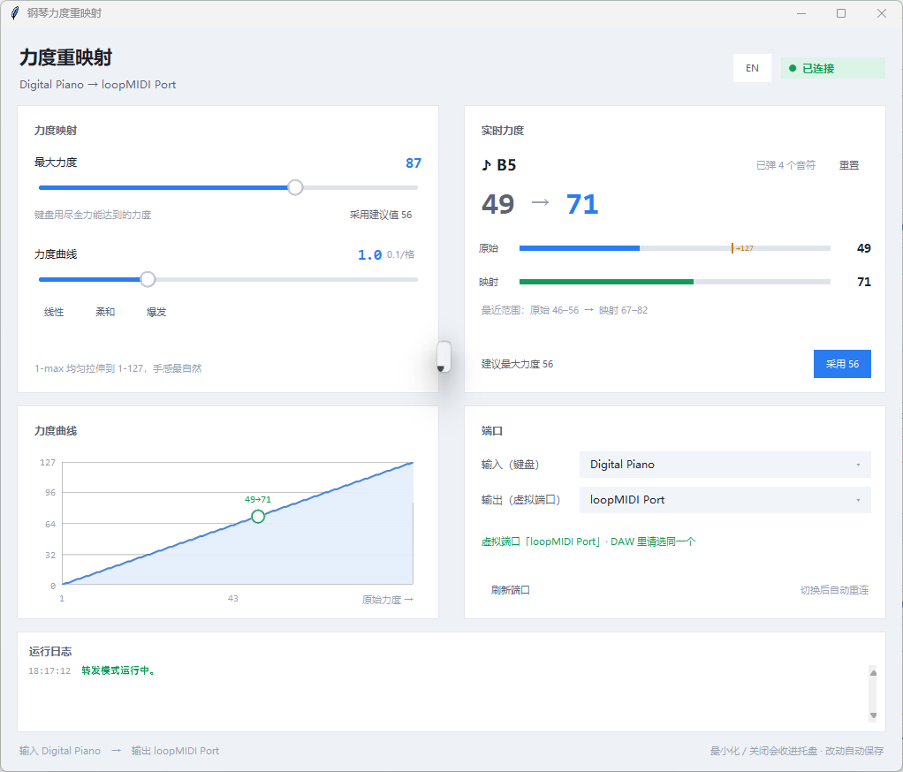

<div align="center">



# 钢琴力度重映射

**把「力度打不满」的 MIDI 键盘，实时重映射成完整的 1–127 力度。**

<p>
  <a href="#-下载"><b>⬇️ 下载</b></a> ·
  <a href="README_EN.md">English</a> ·
  <a href="#-它解决什么问题">解决什么问题</a> ·
  <a href="#-工作原理">工作原理</a> ·
  <a href="#-常见问题">常见问题</a>
</p>

<p>
  
  
  
  
</p>

</div>

---

## 📥 下载

到 **[Releases](../../releases)** 页面下载：

| 版本 | 文件 | 大小 | 说明 |
| --- | --- | --- | --- |
| **v1.2.0** | `PianoVelocityMapper-v1.2.0.zip` | ≈18 MB | 解压双击即用，**不需要装 Python** |

> 压缩包里只有本工具（单文件 exe）和说明文档，**不含任何第三方软件**。
> 虚拟 MIDI 端口工具（loopMIDI）需要你自己从官网装一次，
> 装完之后本工具会**自动帮你启动它**，以后只需要开这一个软件。

> 想自己改代码？直接用本仓库（MIT 许可）：右上角 **Code → Download ZIP**，
> 或者 `git clone` 之后跑 `setup.cmd`（见 [给开发者](#-给开发者)）。

---

## 🤔 它解决什么问题

不少小尺寸键床的 MIDI 键盘（61 键、88 键重锤等）力度键数少，**无论怎么用力砸，
实测最大力度只能到 95–110**，而音源支持到 127。结果就是弹奏整体偏轻、做不出
强力度层次。

这个工具把键盘的「真实上限」重新标定成 127：

```
键盘 (USB-MIDI)  ──►  本工具  ──►  虚拟 MIDI 端口  ──►  你的 DAW / 音源
                    力度 1–max 映射到 1–127
```

**所有 DAW、所有音源统一生效** —— Cubase、FL Studio、Ableton、任意 VST 音源都直接受益，
不用在每个软件里重新画一遍力度曲线。

---

## 🎹 工作原理

```
      ┌──────────────┐        ┌──────────────┐
      │   你的键盘    │  USB   │  本工具       │ 虚拟端口 │   你的 DAW   │
      │  (力度 1~95) │ ─────► │  映射 →1~127 │ ───────► │  音源/工程   │
      └──────────────┘        └──────────────┘         └──────────────┘
```

* 只改写 **Note On 的力度**；力度为 0 的 Note On 原样透传（MIDI 里它等价于 note-off）
* Note Off / CC（含延音踏板 CC64）/ 弯音 / 通道信息等**一律原样透传**
* 中间经过虚拟 MIDI 端口，所以 **DAW 收到的就是重映射之后的力度**

---

## ✨ 功能

| | |
| --- | --- |
| **桌面图形界面** | 双击即用，无命令行窗口；力度、曲线、端口、日志全在窗口里 |
| **系统托盘常驻** | 点 ✕ 问你要不要完全退出；选「留在后台」就缩到托盘继续转发 |
| **界面语言** | 中文 / English 一键切换（右上角按钮），默认中文 |
| **虚拟端口自动接管** | 找不到虚拟端口时，自动启动你已安装的 loopMIDI；实在没有才给引导 |
| **端口列表可滚动** | 端口多的时候浮层自动收进屏幕内，滚轮 / 方向键 / 滚动条都能翻到最后一项 |
| **智能标定** | 弹几下就给出建议的最大力度，一键套用 |
| **力度曲线** | 线性 / 柔和 / 爆发，按手感微调，实时生效 |
| **自动重连** | 键盘拔了再插上、loopMIDI 后启动，都会自己接上 |
| **抗锯齿绘制** | 曲线、落点、滑块手柄都是平滑的，不是阶梯状 |
| **不占 CPU** | 界面静止时几乎不耗资源 |

---

## 🚀 快速上手

### 1. 装一个虚拟 MIDI 端口

硬件 MIDI 口是独占的：工具占着键盘的输入口之后，DAW 就只能去听一个**虚拟端口**。
Windows 上最常见的做法是 [loopMIDI](https://www.tobias-erichsen.de/software/loopmidi.html)（个人使用免费）：

1. 打开官网下载安装
2. 打开 loopMIDI，右键托盘图标 →「添加端口」，名字随意（比如 `Piano`）
3. 保持它运行，端口处于活动状态

> loopMIDI 装好后，本工具**会自动把它启动起来**，通常你什么都不用多做。

### 2. 装本工具

解压 → 双击 `PianoVelocityMapper.exe`。（第一次启动会解压依赖，慢一两秒属正常。）

> 想从源码跑：克隆本仓库 → 装 Python 3.10 ~ 3.13 → 双击 `setup.cmd`
> （只跑一次，会装依赖并建桌面快捷方式）。

### 3. 接进 DAW

把本工具的「**输出（虚拟端口）**」和 DAW 的 MIDI 输入**选成同一个端口**。

* **FL Studio**：`Options > MIDI settings`（F10）→ 勾上那个虚拟端口
* **Cubase**：`Studio > Studio Setup > MIDI Ports` → 勾上 → 本工具的输出也选它

> ⚠️ 别忘了在 DAW 里**停用键盘的直连输入**，否则同一个音符会响两遍（双音符）。

---

## ❓ 常见问题

**Q：窗口顶上显示「没找到输出端口」怎么办？**
虚拟 MIDI 端口还没起来。装好 loopMIDI 并启动它，工具每 2 秒自动重试，不用重启本工具。
点窗口右上角「刷新端口」也可以立刻重扫。

**Q：怎么知道现在用的是不是虚拟端口？**
窗口「端口」卡片下面那行提示会直接告诉你：

* 🟢 绿色 `虚拟端口「loopMIDI Port」· DAW 里请选同一个` —— 对了
* 🟠 橙色 `「xxx」是硬件端口，DAW 收不到重映射后的力度` —— 选错了，换一个

**Q：弹奏出现双音符？**
DAW 里还开着键盘的直连输入，停用它即可。

**Q：怎么知道我的键盘实际最大力度是多少？**
弹几下，窗口里的「建议最大力度」会给出，直接点「采用 xx」。

**Q：可以只改某一个键吗？**
本工具是全局力度重映射（按值缩放）。要单独改某些键，用 DAW 里的力度曲线或
MIDI 插件更合适。

**Q：关掉窗口后还会继续转发吗？**
点 ✕ 会问你要不要完全退出。选「留在后台运行」就缩到托盘继续转发（托盘图标在
任务栏右下角，可能藏在 `^` 展开的折叠区里），选「完全退出」才结束进程。

**Q：为什么它不自带 loopMIDI？**
Tobias Erichsen 明确要求「未经作者书面同意不得以任何方式分发」他的软件。
本工具只负责**启动你自己装的那一份**，不夹带二进制。

更多问题看 [`docs/详细说明.md`](docs/详细说明.md)。

---

## 🛠️ 给开发者

```powershell
# 跑起来
python -m venv .venv
.venv\Scripts\pip install -r requirements.txt
.venv\Scripts\python app.py

# 打单文件 exe
.venv\Scripts\pip install pyinstaller
.venv\Scripts\python build_exe.py

# 组装分发包（release\PianoVelocityMapper-v<版本>.zip）
powershell -ExecutionPolicy Bypass -File make_release.ps1 -Version 1.2.0
```

仓库里还带了 GitHub Actions：推一个 `v*` 标签，就会自动在 Windows 上打包并把
压缩包附到对应的 Release 上。

| 文件 | 作用 |
| --- | --- |
| `app.py` | 入口 |
| `gui.py` | 图形界面（tkinter 自绘） |
| `tray.py` | 系统托盘图标（纯 ctypes，不依赖第三方库） |
| `engine.py` | MIDI 后台线程 |
| `velocity_mapper.py` | 核心映射逻辑 + 端口查找 |
| `midi_ports.py` | 虚拟端口检测 / 找 loopMIDI / 自动拉起它 |
| `i18n.py` | 界面语言（中英双语） |
| `paths.py` | 区分只读资源目录 / 可写数据目录（打包 exe 时要用） |
| `aa.py` | 抗锯齿绘图 |
| `webui.py` / `webui.html` | 可选的网页控制台 |

---

## 📄 许可

本项目采用 [MIT 许可](LICENSE)。

打包进 exe 的第三方组件：

| 组件 | 许可 |
| --- | --- |
| [mido](https://github.com/mido/mido) | MIT |
| [pygame](https://www.pygame.org) | LGPL-2.1-or-later |

详见 [`third_party_licenses.txt`](third_party_licenses.txt)。

## 🙏 致谢

* [loopMIDI](https://www.tobias-erichsen.de/software/loopmidi.html) —— Tobias Erichsen，免费且好用的虚拟 MIDI 端口工具
* [mido](https://github.com/mido/mido) —— 友好的 MIDI 消息库
* [pygame](https://www.pygame.org) —— 本项目的抗锯齿绘制靠它
