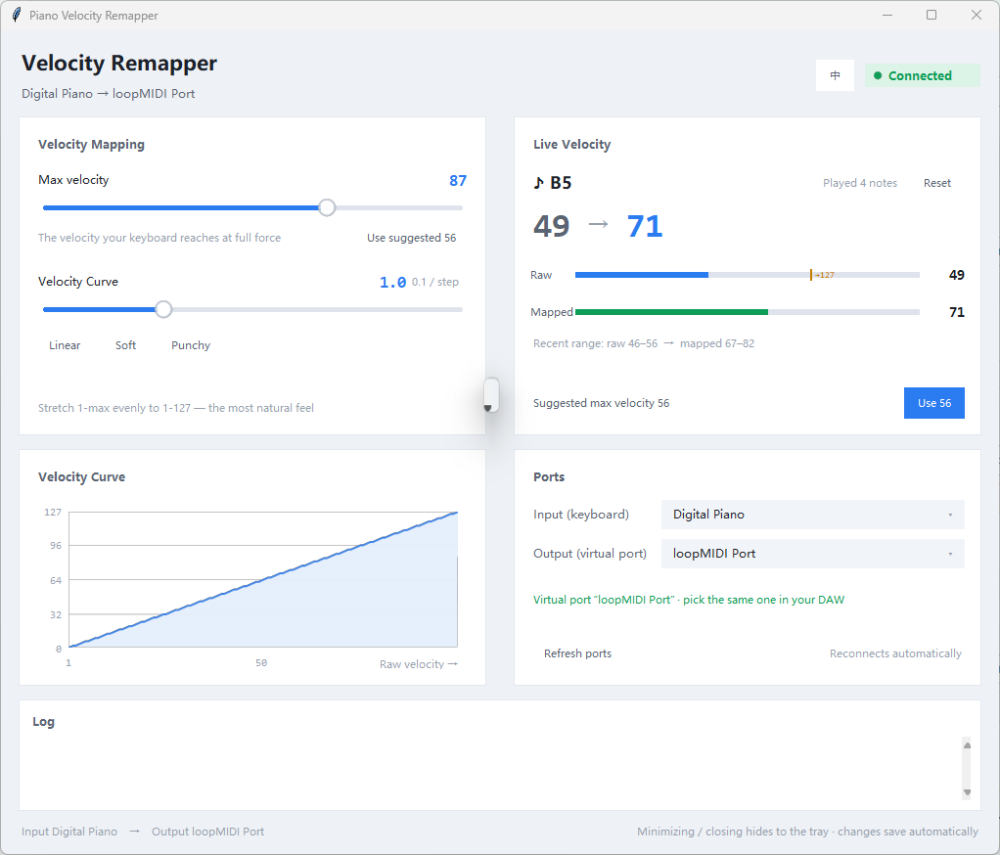

<div align="center">



# Piano Velocity Remapper

**Remap a "weak" MIDI keyboard's velocity to the full 1–127 range, in real time.**

<p>
  <a href="#-download"><b>⬇️ Download</b></a> ·
  <a href="README.md">中文</a> ·
  <a href="#-the-problem-it-solves">The problem</a> ·
  <a href="#-how-it-works">How it works</a> ·
  <a href="#-faq">FAQ</a>
</p>

<p>
  
  
  
  
</p>

</div>

---

## 📥 Download

Grab it from the **[Releases](../../releases)** page:

| Build | File | Size | Who it's for |
| --- | --- | --- | --- |
| **Standalone** (recommended) | `PianoVelocityMapper-Green-v1.0.0.zip` | ≈18 MB | Just want it to work: unzip, double-click — **no Python needed** |
| **Source** | `PianoVelocityMapper-Source-v1.0.0.zip` | ≈80 KB | You want to read, modify or build it yourself |

> Neither archive bundles any third-party software. You install a virtual MIDI port
> tool ([loopMIDI](https://www.tobias-erichsen.de/software/loopmidi.html)) yourself
> once — after that this app **starts it for you**, so there's only one program
> to launch from now on.

---

## 🤔 The problem it solves

Plenty of small-keybed MIDI keyboards (61-key, 88-key weighted, …) have a limited
number of velocity keys. No matter how hard you hit them, the **measured maximum
tops out around 95–110**, while your instrument supports the full 127. The result
is everything plays a bit soft and you lose the top end of the dynamic range.

This tool re-calibrates the keyboard's real maximum to 127:

```
Keyboard (USB-MIDI) ──► This tool ──► Virtual MIDI port ──► Your DAW / instrument
                        velocity 1–max mapped to 1–127
```

**It works everywhere at once** — Cubase, FL Studio, Ableton, any VST
instrument. You don't have to redraw a velocity curve in every piece of software.

---

## 🎹 How it works

```
      ┌──────────────┐        ┌──────────────┐
      │  Your        │  USB   │  This tool   │ virtual │   Your DAW   │
      │  keyboard    │ ─────► │  map →1~127  │ port ──► │  / instrument│
      │ (vel 1~95)   │        └──────────────┘         └──────────────┘
      └──────────────┘
```

* Only **Note On velocity** is rewritten; Note On with velocity 0 passes through
  untouched (in MIDI it is equivalent to note-off)
* Note Off / CC (including sustain pedal CC64) / pitch bend / channel messages are
  **passed through unchanged**
* The MIDI travels through a virtual port, so **your DAW receives the remapped
  velocity**, not the original one

---

## ✨ Features

| | |
| --- | --- |
| **Native desktop GUI** | Double-click to run, no console window; velocity, curve, ports and log all live in one window |
| **Stays in the system tray** | Closing asks whether to quit; choose "keep running" and it keeps forwarding from the tray |
| **Chinese / English UI** | One-click language switch (top right), Chinese by default |
| **Virtual port, handled** | Starts your installed loopMIDI automatically; only shows a setup guide if there's really nothing to find |
| **Smart calibration** | Play a few notes and it suggests the right max velocity — one click to apply |
| **Velocity curve** | Linear / Soft / Punchy, adjusted to taste, applied live |
| **Auto-reconnect** | Unplug the keyboard, start loopMIDI later — it reconnects by itself |
| **Anti-aliased drawing** | Curves, dots and slider handles are smooth, not stair-stepped |
| **Idle CPU ≈ 0** | The interface costs almost nothing when nothing is happening |

---

## 🚀 Quick start

### 1. Set up a virtual MIDI port

Hardware MIDI ports are exclusive: once this tool holds the keyboard's input, your
DAW has to listen to a **virtual port** instead. On Windows the usual choice is
[loopMIDI](https://www.tobias-erichsen.de/software/loopmidi.html) (free for
personal use):

1. Download and install it from the official site
2. Open loopMIDI, right-click its tray icon → *Add Port*, any name you like
3. Leave it running with the port active

> Once loopMIDI is installed this tool **starts it for you** — you usually don't
> have to do anything else.

### 2. Install this tool

* **Standalone:** unzip → double-click `PianoVelocityMapper.exe`
* **Source:** install Python 3.10 – 3.13 → double-click `setup.cmd` (run it once;
  it installs the dependencies and creates a desktop shortcut)

### 3. Wire it into your DAW

Pick the **same** port for this tool's *Output (virtual port)* and for your DAW's
MIDI input.

* **FL Studio:** `Options > MIDI settings` (F10) → tick the virtual port
* **Cubase:** `Studio > Studio Setup > MIDI Ports` → tick it → and pick the same
  one as this tool's output

> ⚠️ Remember to **disable the keyboard's direct input** in your DAW, otherwise
> every note fires twice (double notes).

---

## ❓ FAQ

**Q: The window says "output port not found".**
Your virtual MIDI port isn't up yet. Install and start loopMIDI — the tool retries
every 2 seconds, no restart needed. *Refresh ports* in the window forces an
immediate rescan.

**Q: How do I know whether I'm using a virtual port?**
The line under the *Ports* card tells you directly:

* 🟢 green `Virtual port "loopMIDI Port" · pick the same one in your DAW` — correct
* 🟠 orange `"xxx" is a hardware port — your DAW won't get the remapped velocity`
  — wrong one, pick another

**Q: I'm getting double notes.**
Your DAW still has the keyboard's direct input enabled — turn it off.

**Q: What's my keyboard's real maximum velocity?**
Play a few notes; the window suggests a *Suggested max velocity*. Click *Use* to
apply it.

**Q: Can I remap only certain keys?**
This tool does a global velocity remap (a value scaling). To tweak individual
keys, use your DAW's velocity curve or a MIDI plugin.

**Q: Does it keep forwarding after I close the window?**
Clicking ✕ asks whether to quit completely. *Keep running in background* hides it
to the system tray and forwarding continues (look in the notification area, it may
be behind the `^` overflow arrow). *Quit completely* ends the process.

**Q: Why doesn't it bundle loopMIDI?**
Tobias Erichsen requires written consent before his software is redistributed.
This tool only *launches the copy you installed yourself* — it never bundles it.

More details in [`docs/DETAILS_EN.md`](docs/DETAILS_EN.md).

---

## 🛠️ For developers

```powershell
# run it
python -m venv .venv
.venv\Scripts\pip install -r requirements.txt
.venv\Scripts\python app.py

# build the standalone exe
.venv\Scripts\pip install pyinstaller
.venv\Scripts\python build_exe.py

# assemble both distribution archives
powershell -ExecutionPolicy Bypass -File make_release.ps1
```

GitHub Actions is included too: push a `v*` tag and it builds the exe on Windows
and attaches it to the matching Release automatically.

| File | What it does |
| --- | --- |
| `app.py` | Entry point |
| `gui.py` | The GUI (hand-drawn with tkinter) |
| `tray.py` | System tray icon (pure ctypes, no third-party dependency) |
| `engine.py` | Background MIDI thread |
| `velocity_mapper.py` | Core mapping logic + port lookup |
| `midi_ports.py` | Detects virtual ports, finds loopMIDI, starts it |
| `i18n.py` | Interface language (Chinese / English) |
| `paths.py` | Separates read-only resources from writable data (needed when packaging) |
| `aa.py` | Anti-aliased drawing |
| `webui.py` / `webui.html` | Optional web console |

---

## 📄 License

[MIT](LICENSE).

Third-party components bundled into the exe:

| Component | License |
| --- | --- |
| [mido](https://github.com/mido/mido) | MIT |
| [pygame](https://www.pygame.org) | LGPL-2.1-or-later |

See [`third_party_licenses.txt`](third_party_licenses.txt) for details.

## 🙏 Credits

* [loopMIDI](https://www.tobias-erichsen.de/software/loopmidi.html) — Tobias Erichsen, a free and excellent virtual MIDI port tool
* [mido](https://github.com/mido/mido) — a friendly MIDI message library
* [pygame](https://www.pygame.org) — powers the anti-aliased drawing here
